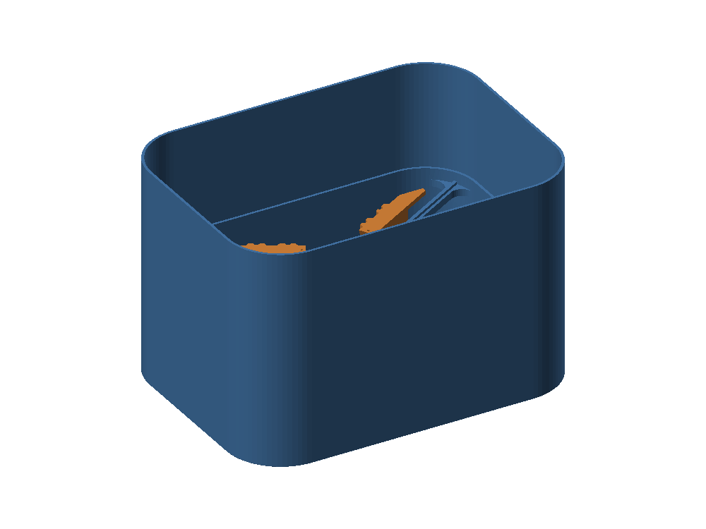
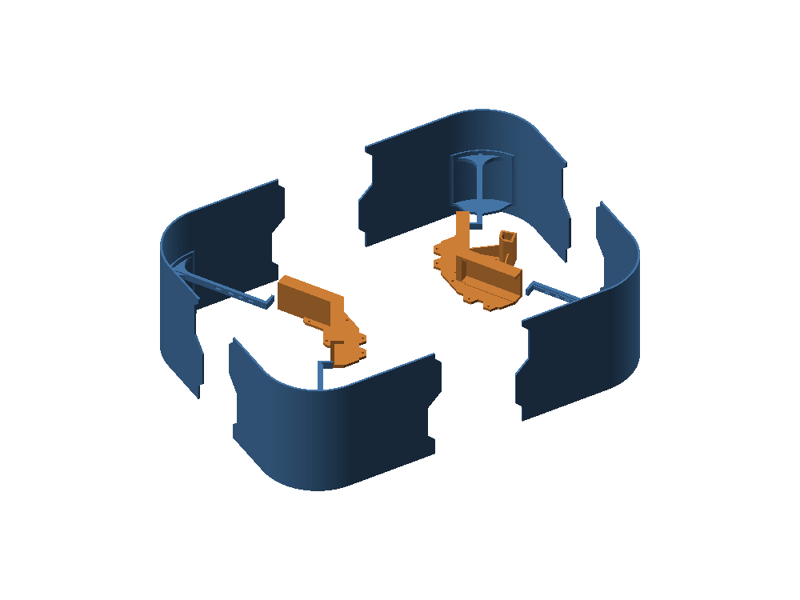
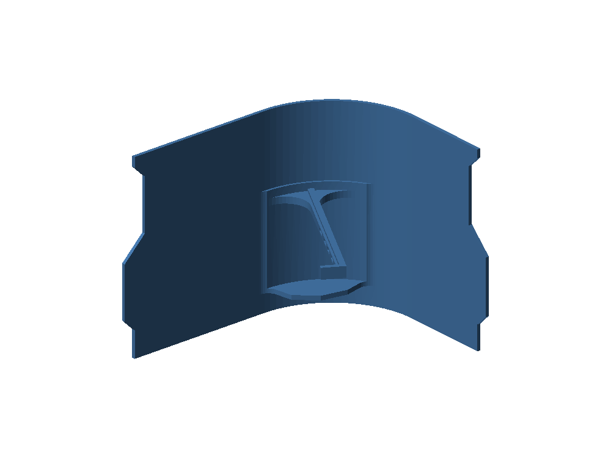
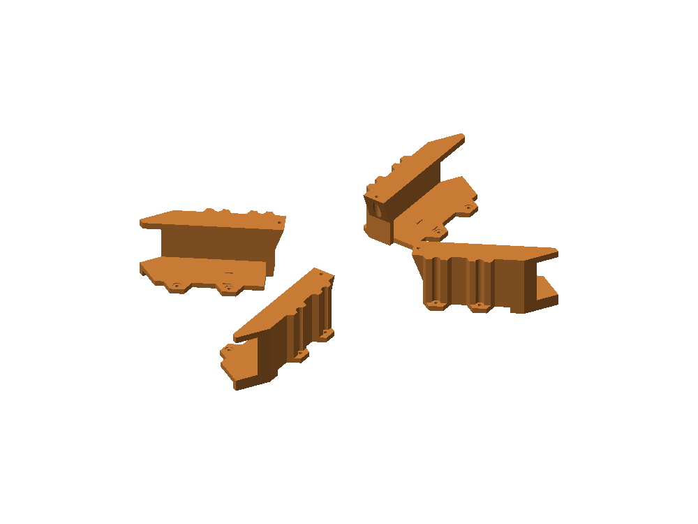
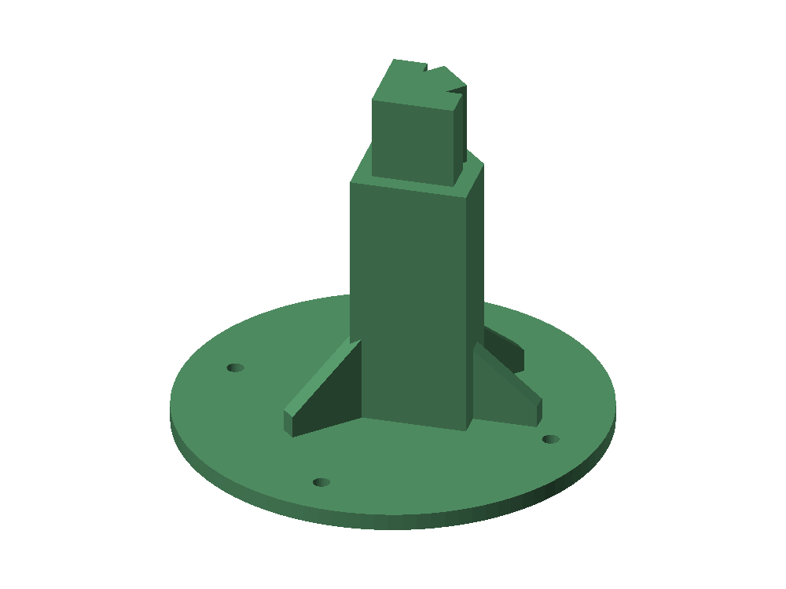
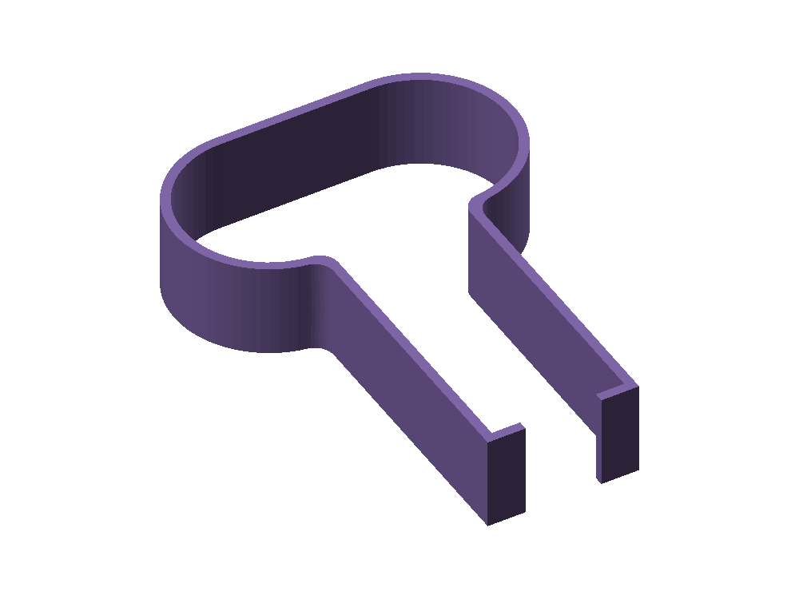
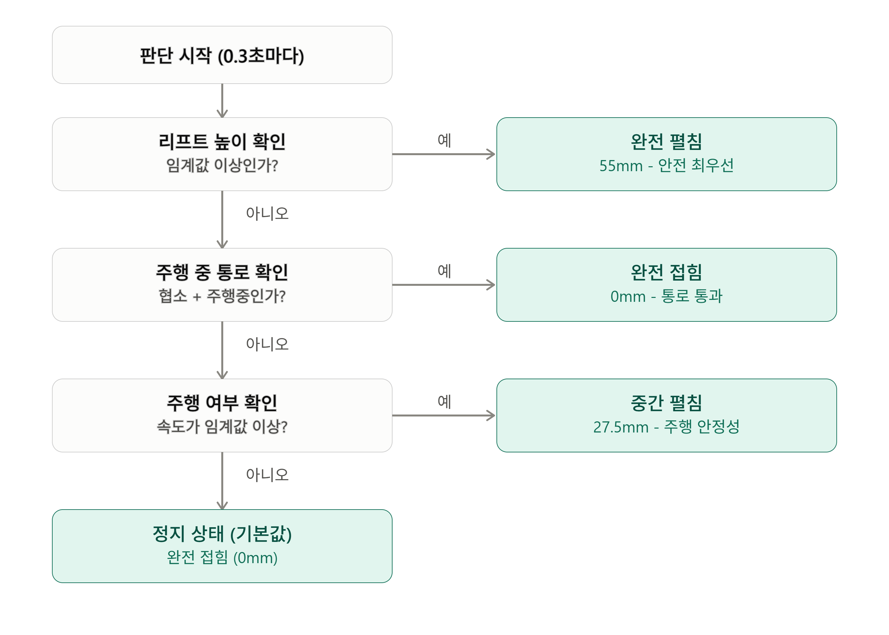

# Smart Up-care: 가변폭 섀시 제어 시스템

> 🏆 **2026 한이음 드림업 공모전 동상**
> AI 멀티모달 가변 형상 돌봄 로봇(AMR) 중 **가변폭 섀시**의 기구 설계와 제어

## 시연 영상

| 시연 1 | 시연 2 |
| --- | --- |
|  |  |

▶ 이미지를 누르면 YouTube에서 가변폭 섀시와 리프트 동작 영상을 볼 수 있습니다.

## 개요

요양시설의 좁은 복도와 넓은 공간을 모두 다니려면 로봇 폭이 상황에 따라 바뀌어야 합니다.
이 서브시스템은 LiDAR, 주행 상태, 리프트 상태를 종합해 **섀시 폭을 0~55 mm 범위에서 자동으로 조절**합니다.

## 내 역할

- 로봇 전체 시스템 구조 설계
- 가변폭 섀시와 외곽 **기구 설계** (Fusion 360)
- 섀시 **제어 소프트웨어** 개발: GRBL 시리얼 제어, ROS2 자율 제어 노드
- 다른 파트(리프트, LiDAR, 구동부)와의 **인터페이스 정의 문서** 작성: 토픽, 데이터 포맷, 포트, 주기를 정리해 팀 통합 기준으로 사용

## 시스템 구성

~~~
LiDAR (/scan)        ─┐
Odometry (/odom)     ─┼─▶ chassis_controller (ROS2, Jetson)
Lift (/lift/state)   ─┘            │ USB Serial
                                    ▼
                          MKS DLC32 (GRBL) ─▶ Stepper ×4
~~~

| 구성 요소 | 내용 |
| --- | --- |
| 메인 컴퓨터 | NVIDIA Jetson (ROS2) |
| 모터 컨트롤러 | MKS DLC32 + GRBL, USB 시리얼 연결 (115200 bps) |
| 액추에이터 | 스테퍼 모터 4개 (X, Y1, Y2, Z축), STEPS_PER_MM = 666.67 |
| 가동 범위 | 0~55 mm (기구 한계 보호를 위해 55 mm로 제한) |
| 원점 | 완전히 접힌 위치를 리밋 스위치로 감지 |

## 기구 설계

섀시와 몸체 연결부, LiDAR 마운트를 Fusion 360으로 직접 설계하고 3D 프린팅으로 제작했습니다. 아래 STL 파일을 누르면 GitHub에서 3D로 돌려볼 수 있습니다.

| 조립 형상 | 분해도 |
| --- | --- |
|  |  |

### 설계 변경: 기존 설계의 문제 → 최종 설계

| 기존 설계의 문제 | 최종 설계 |
| --- | --- |
| Jetson이 들어갈 공간이 부족함 (심각) | 몸체 연결부를 새로 설계해 Jetson Orin Nano와 모터 드라이버 공간을 확보하고, 높이를 최소화해 저중심 설계 |
| 3D 프린터 적층 방향이 힘을 받는 수직 방향이라 다리 강성이 부족함 | 힘을 받는 방향과 적층 방향이 수직이 되도록 설계해 뒤틀림을 막고 전단 한계를 높임 |
| 출력 시간과 서포트가 너무 많이 필요함 | 출력 효율을 위해 몸체 강성을 약간 양보 (실차 조립에서 문제없음을 확인) |

### 부품별 설계 포인트

| 부품 | 크기 (mm) | 설계 포인트 | 파일 |
| --- | --- | --- | --- |
| 섀시 ×4 | 202 × 150 × 247 | 다리에 T 구조 적용, 응력 집중을 피하는 유선형·둔각 설계, 볼캐스터 휠 하중을 받는 수직 보강면 두께 추가, 접힐 때 맞물려 들어가도록 절단면에 경사 | [q1](hardware/shell_q1.stl) · [q2](hardware/shell_q2.stl) · [q3](hardware/shell_q3.stl) · [q4](hardware/shell_q4.stl) |
| 몸체 연결부 ×4 | 98 × 66 × 47 | 연결부 2개를 합쳐 흔들림 최소화, 'ㄷ' 구조로 섀시와 상부 리프트 무게까지 지지 | [1](hardware/body_connector_1.stl) · [2](hardware/body_connector_2.stl) · [3](hardware/body_connector_3.stl) · [4](hardware/body_connector_4.stl) |
| LiDAR 마운트 | Ø76 × 64 | 탈부착식, LiDAR 무게와 회전 원심력에 의한 진동을 막는 삼각 리브 | [lidar_mount.stl](hardware/lidar_mount.stl) |
| 핀 | 18 × 25 × 5 | 부품 고정용 | [pin.stl](hardware/pin.stl) |

### 남은 문제

확장 레일의 정확한 도면이 없어 섀시 다리를 정밀하게 맞추지 못했고, 리니어 액추에이터와 다리 사이에 간섭이 생겼습니다. 글루건으로 고정해 해결했지만 접착력이 약해 시연 때 주의가 필요했습니다.

## 제어 로직

ROS2 노드 `chassis_controller`가 세 토픽을 구독하고, 아래 우선순위로 목표 폭을 정합니다.

| 우선순위 | 조건 | 섀시 폭 |
| --- | --- | --- |
| 1 | 리프트가 올라감 (MID/TOP) | 55 mm (완전 확장, 전복 방지) |
| 2 | 주행 중 + 전방 ±20° 장애물 근접 | 0 mm (완전 접힘, 좁은 통로 통과) |
| 3 | 주행 중 | 27.5 mm (중간) |
| 4 | 정지 | 0 mm |

- LiDAR `/scan`에서 정면 ±20° 구간의 최소 거리만 보고 0.5 m 이내면 협소 통로로 판단합니다.
- 상태가 **바뀔 때만** 명령을 보내 시리얼 통신 부하를 줄였습니다.
- 리프트 상태를 아직 받지 못하면 `UNKNOWN`으로 두고 안전한 완전 확장 쪽을 기본값으로 둡니다.
- 팀원 서브시스템(리프트, LiDAR/SLAM, 구동부)과는 하드웨어를 공유하지 않고 **ROS2 토픽으로만** 통합했습니다.

## 신뢰성을 위한 설계

- **GRBL 핸드셰이크**: 명령마다 `ok`를 기다리고, 이동이 끝나 `Idle`이 될 때까지 대기해 버퍼 오버플로로 명령이 씹히는 문제를 막았습니다.
- **리밋 스위치 홈잉**: 먼저 10 mm 펼쳐 스위치에서 떨어진 뒤 수축하고, 스위치가 하나라도 눌리면 10 mm 더 당겨 원점(`G92`)을 잡습니다.
- **모터 보호**: 8초 안에 스위치가 감지되지 않으면 홈잉을 강제로 멈춥니다. 55 mm를 넘는 명령은 보내지 않습니다.
- **배선 반전 보정**: Y축 배선이 반대로 되어 있어 조그 키 매핑에서만 보정했습니다.

## 수동 테스트 도구

키보드로 섀시를 직접 움직여 검증하는 스크립트도 만들었습니다 (Jetson/Linux용, Windows용 두 버전).

- `0`: 자동 원점 복귀 (8 mm씩 이동하며 ok/Idle 핸드셰이크, 8초 타임아웃 안전 차단)
- `Z`: 현재 위치를 수동으로 원점 설정
- `1` / `2` / `3`: 0 / 27.5 / 55 mm 위치로 이동
- `W/S/A/D/R/F`: 축별 개별 조그

## 개발 과정과 문제 해결

| 시기 | 진행 | 문제 → 대응 |
| --- | --- | --- |
| 7월 초 | 외곽 모델링: H빔·T빔·삼각 리브, 높은 지지대 구조 | 막대 하나가 섀시 무게를 모두 지지해 파손 위험 → 경량화와 강성 확보를 함께 고려 |
| 7월 초 | 폭 조절 v1: MKS DLC32 + A4988, AccelStepper 펌웨어, Jetson과 UART 통신, 리프트 높이에 따라 단계 조절 | 스테퍼 발열이 큼 → 목표 위치에 도달하면 드라이버 전원을 끔 (웜기어라 전원이 꺼져도 위치 유지) |
| 7월 말 | 부품 통합 점검 | Jetson·배터리 공간 부족, LiDAR는 리프트 위에 달 수 없음 → 본체 연결부를 타이트하게 재설계, LiDAR 마운트 별도 제작 |
| 9월 | 섀시·몸체 연결부 재설계 | Jetson 공간 부족, 적층 방향 때문에 다리 강성 부족 → 몸체 연결부 재설계, T 구조와 적층 방향 변경 (위 기구 설계 참고) |
| 이후 | GRBL 시리얼 제어 + ROS2 노드로 전환 | 80 mm까지 펼치면 하드웨어가 파손 → 가동 범위를 0~55 mm로 제한 |
| 10월 | 최종 시연 | Jetson USB 포트가 부족해 LED와 리프트 ESP32를 동시에 연결하지 못함, 리프트 스테퍼 미작동, 이동 중 충격으로 액추에이터 연결부 파손 |

### 배운 점

- **마감이 성능이다.** 튼튼하고 유격 없이 만들고, 브레드보드 대신 PCB와 맞춤 부품을 써야 합니다.
- 상용 전선은 무겁고 유연하지 않아 배선까지 설계에 포함해야 합니다.
- 팀원 작업물 통합은 마지막이 아니라 **중간중간 반드시** 해야 합니다.
- MCU·보드의 포트 수 같은 제약(Jetson USB 4개)을 처음부터 설계에 넣어야 합니다.

## 팀

| 이름 | 담당 |
| --- | --- |
| 이승우, 이준하 | 구동부 (메카넘 휠) |
| 구영인 | LiDAR, SLAM |
| 김효선 | 리프트 제어 |
| **김희진** | 섀시, 외곽 디자인, 섀시 제어 |

## 기술 스택

`ROS2` `Python` `NVIDIA Jetson` `GRBL` `Fusion 360`
